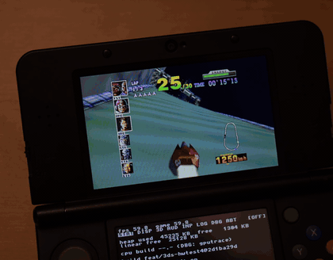
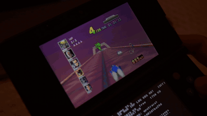
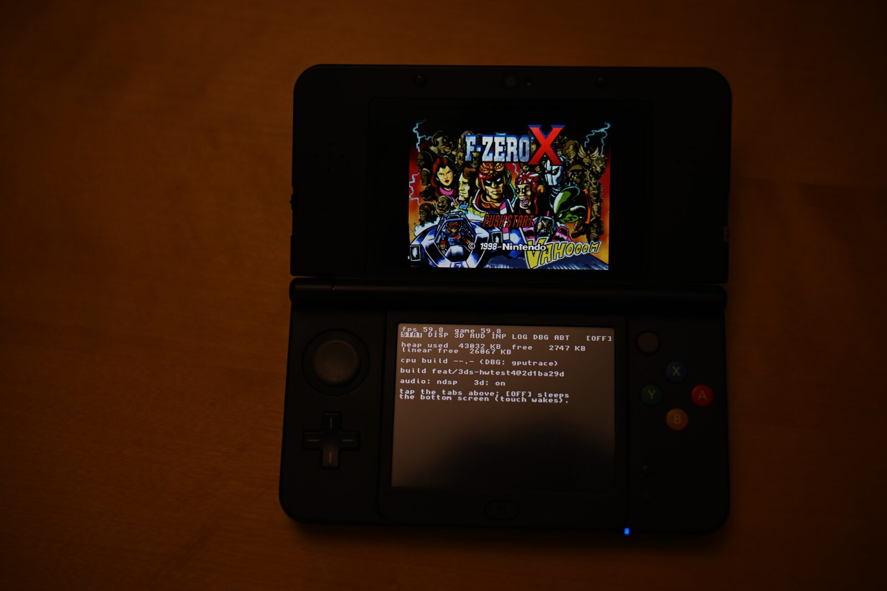
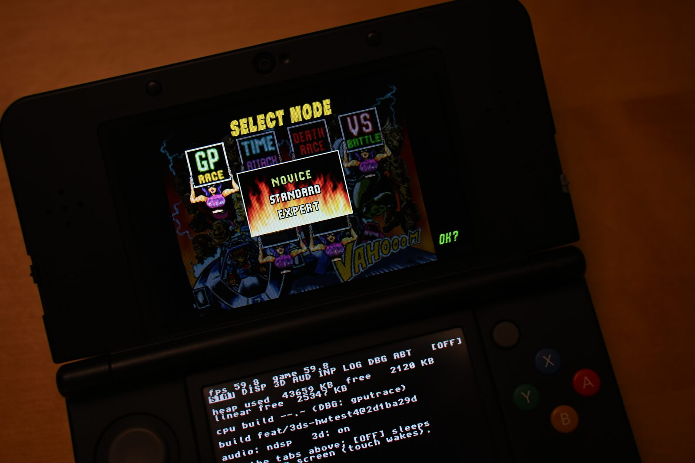
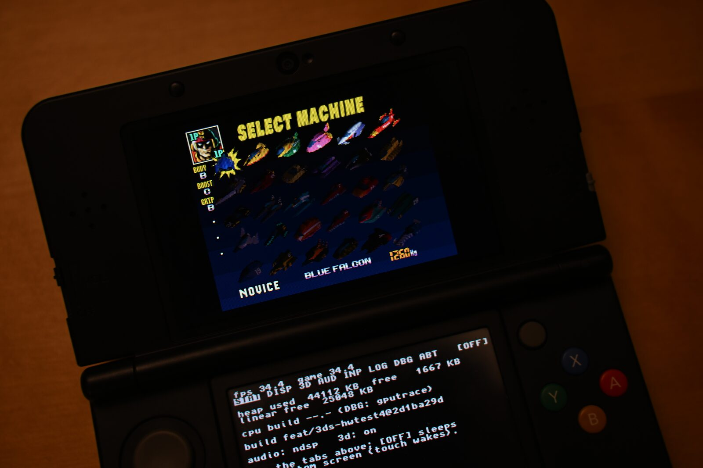
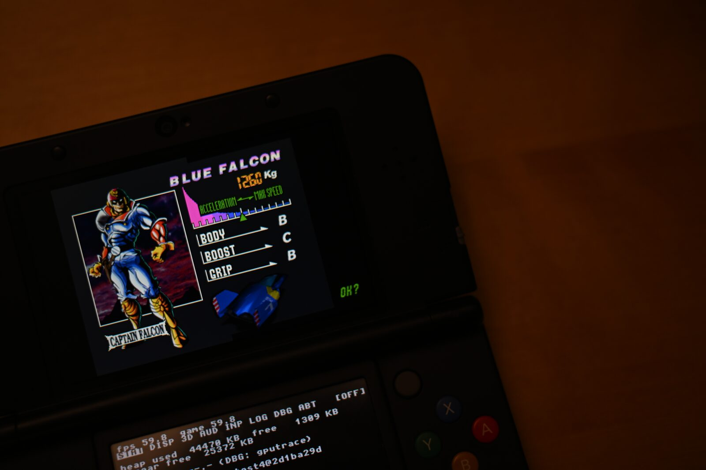
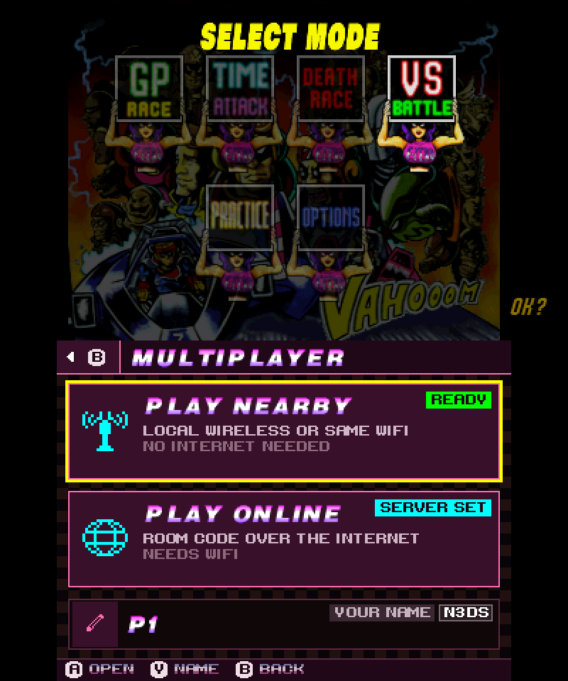
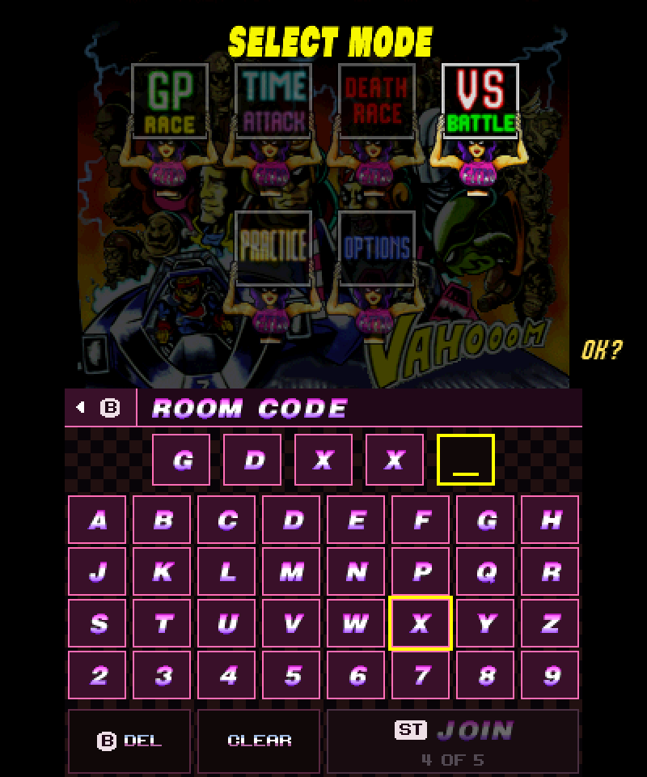
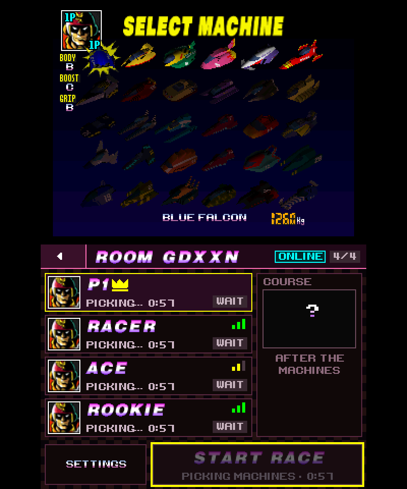
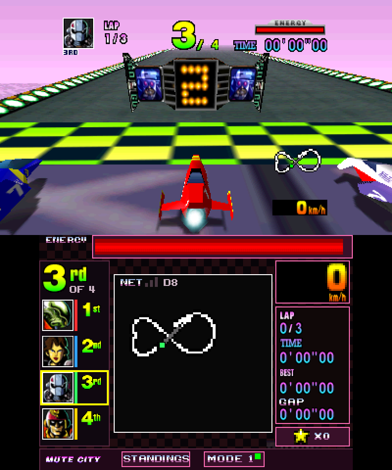

# G-Diffuser 3DS — F-Zero X on Nintendo 3DS

A native port of the **F-Zero X decompilation** to Old and New Nintendo 3DS, built on the
G-Diffuser PC port. Full stereoscopic 3D, full audio, and an optional on-console **Expansion Kit**
(64DD content, streamed from the SD card).

> **This is a fan-made, educational software-preservation project.**
> See [Legal](#legal) before downloading or building anything.

## Download

Pick the file that matches your console from the
[latest release](https://github.com/cruxxxxxx/gdx-3ds/releases/latest) (checksums in
`SHA256SUMS`):

| Build | Console | Content | Files |
|---|---|---|---|
| `O3DS` | Old 3DS / 2DS | F-Zero X | `G-Diffuser-3DS-O3DS.3dsx` / `.cia` |
| `N3DS` | New 3DS / New 2DS XL | F-Zero X | `G-Diffuser-3DS-N3DS.3dsx` / `.cia` |
| `N3DS-EK` | New 3DS | F-Zero X + Expansion Kit | `G-Diffuser-3DS-N3DS-EK.3dsx` / `.cia` |

Easiest: grab the zip for your build, e.g. `G-Diffuser-3DS-O3DS-v1.1.0.zip`. It is laid out like
an SD card (`3ds/…3dsx`, the `.cia` at the top, a short README.txt), so you unzip it onto the SD
card's root.

Use the build for your console — an `N3DS` build does not fit an Old 3DS's memory budget. The
`N3DS-EK` build additionally needs your own 64DD disk dump — see [Expansion Kit](#expansion-kit)
below for what happens without one. `.3dsx` runs from the Homebrew Launcher, `.cia` installs to
the HOME menu (needs Luma3DS and sigpatches) — both come from the same build and share saves,
settings and logs.

## Quick install

1. Download the zip (or the `.3dsx` / `.cia`) for your console (table above).
2. Clone this repository with **git** to get `tools/prebake/prebake.py` — it's not in the release
   download. Do **not** use GitHub's "Download ZIP" button: that leaves the `decomp` submodule
   empty and the next step will fail.
   ```sh
   git clone https://github.com/cruxxxxxx/gdx-3ds.git
   cd gdx-3ds
   git submodule update --init decomp
   ```
   (Only `decomp` is needed for this step. To build from source later, add the rest by name:
   `git submodule update --init decomp torch`, plus `fzerox-expansion-kit` for an EK build.)
3. On your PC, dump your own F-Zero X (USA, rev 0) cartridge, download `gdx-extract` for your OS
   (Windows / macOS / Linux) from the same release, and run:
   ```sh
   python3 tools/prebake/prebake.py --rom /path/to/your-dumped-rom.z64 --extractor /path/to/gdx-extract
   ```
   This produces `fzerox.o2r` and `gdiffuser.o2r`. The console never sees your ROM — this step
   runs entirely on your computer.
4. Copy both `.o2r` files to `sdmc:/3ds/gdiffuser/`, and unzip the release zip onto the SD root so the
   `.3dsx` lands in `sdmc:/3ds/` (or install
   the `.cia` with [FBI](https://github.com/Steveice10/FBI/releases)). `-EK` builds: also copy
   your 64DD disk image — see [Expansion Kit](#expansion-kit) below.
5. **Dump your console's DSP firmware once, if you haven't already:** install the **DSP1**
   homebrew app and press B to write `sdmc:/3ds/dspfirm.cdc`. Without this the game runs but is
   completely silent — see [`docs/3DS-HARDWARE.md`](docs/3DS-HARDWARE.md#7-audio-dumping-dspfirmcdc-one-time-every-console).
6. Launch from the Homebrew Launcher or the HOME menu.
7. That's it — the native renderer and stereoscopic 3D are on by default on both consoles; you
   don't need to write any `gdiffuser.ini` lines for performance. The file is optional, for
   hand-tuning or reverting to the bare defaults. See [Performance](#performance).

Full steps, the complete SD card layout, the DSP firmware dump audio needs, and troubleshooting:
**[`docs/3DS-HARDWARE.md`](docs/3DS-HARDWARE.md)**.

## On hardware

**v1.0** — New 3DS, with the DASH dashboard on the bottom screen: its idle view on the menus, and
the race dashboard (energy, position, lap times, course map) during a race.

<table>
  <tr>
    <td><a href="docs/media/v1-menu.jpg"></a></td>
    <td><a href="docs/media/v1-race.jpg"></a></td>
  </tr>
</table>

**v0.9** (2026-09) — the first New 3DS release, before DASH: the bottom screen is the debug console.

<p align="center">
  
  
</p>

<table>
  <tr>
    <td><a href="docs/media/title.jpg"></a></td>
    <td><a href="docs/media/menu.jpg"></a></td>
  </tr>
  <tr>
    <td><a href="docs/media/character1.jpg"></a></td>
    <td><a href="docs/media/character2.jpg"></a></td>
  </tr>
</table>

Full-quality v0.9 clips: [Grand Prix](https://cruxxxxxx.github.io/gdx-3ds/media/gameplay-race.mp4) ·
[handheld](https://cruxxxxxx.github.io/gdx-3ds/media/gameplay-handheld.mp4).

## Multiplayer

2–4 players per room, each on their own 3DS: nearby over local wireless or the same Wi-Fi, or
online with a room code. Races run in lockstep, so only controller inputs and state checks cross
the network. Online rooms meet through a small rendezvous server; consoles connect directly where
they can, and otherwise the server relays those same race packets. No game data passes through
it. Player guide: **[`docs/MULTIPLAYER.md`](docs/MULTIPLAYER.md)**.

<table>
  <tr>
    <td><a href="docs/media/mp-menu.png"></a></td>
    <td><a href="docs/media/mp-join-code.png"></a></td>
  </tr>
  <tr>
    <td><a href="docs/media/mp-machine-select.png"></a></td>
    <td><a href="docs/media/mp-race-countdown.png"></a></td>
  </tr>
</table>

Captured in the emulator (Azahar), not on hardware: four instances racing online through a local
server.

## Author's notes

Hello reader. This is the only section of this project written by a real human. Isn't that kind of neat? Well, I guess it depends on how you feel about all of these changes in our lives. In this section, I'll quickly detail my thoughts on this 100% AI generated port, its reflection on the direction of software development, and my own experience in using Claude Code to create it.

---

Awhile back I saw [Chris Lewis make a post about using Claude](https://blog.chrislewis.au/using-coding-agents-to-decompile-nintendo-64-games/) to assist in the Snowboard Kids 2 decompilation. It got me thinking: what a perfect use-case for a coding agent. It's a long running, tedious, endeavor of classification and definition.

I realized that one day I'd like to port F-Zero X to 3DS using a coding agent when it was decompiled/ported. So when [G-Diffuser](https://github.com/Zorkats/G-Diffuser) port was released based on the [Inspectredc Decompilation](https://github.com/inspectredc/fzerox), I gave it a shot. I pulled a bunch of adjacent repositories & documentation together, fed it to Claude using deep research, read the master plan and gave it the OK to spin up a bunch of subagents. For 3 weeks, I babysat and assumed a role somewhere between a Product Owner and a QA tester.

1. Claude suggests an implementation strategy to either fix a bug or improve performance.
2. I approve the suggestion, push back, or do research/implore research if we seem to hit a dead end.
3. Claude works and validates in Azahar emulator.
4. Claude provides a build and I test on 3DS.
5. I report back and provide debug logs. Loop continues.

This continued until it was 'done'. It still totally blows my mind that after 24 days I can play F-Zero X in 3D at a near solid 60fps.

---

Since my first experience using ChatGPT in 2022, I was filled with total existential dread. I saw my livelihood threatened, as this skill I had dedicated my life to became immediately devalued. Since then, I've used LLM chatbots & coding tools extensively and I've oscillated between feelings of fascination, fear, humility, intrigue, reward, and emptiness.

This project revealed to me how much things have changed. The complexity of this project cannot be overstated: this is a marvel. This is nothing short of a miracle. And it was done by a machine, with no human intervention on the code. I never read a line. I never made a true technical decision.

I learned how to program 15 years ago with the dream of contributing projects like this, and since then I've come to a stark realization: while I COULD plausibly port F-Zero X to the 3DS by hand, the time in my life IS finite, and when weighed against other life pursuits such as making an original game, it would not serve me well. I'm sure the journey would make me a better programmer. I'm sure I would learn so much about graphics rendering, address-space heuristics, the 3DS architecture, edge device profiling, etc. And I wholeheartedly thank & admire everyone whose work this is built off of, many of you are nameless but overwhelmingly appreciated.

The (terrifying) fact is: this would've taken me a few thousand hours of my life. For professionals, this might've cost nearly 80x to make (actually, even more, because Claude is currently subsidized).

So to any naysayers, feel free to not play. I understand. The ethics of LLMs are muddy and their incoming impact on society is understated. This project, in my opinion, serves as proof of the latter. However, to anyone who has ever dreamed of F-Zero X 3DS, enjoy.

---

Update, 2026-10-27:

Hello again, reader. Since I published this about 2 months ago, it has taken on a bit of a life of its own and been a catalyst for discussion around Agentic development. There's been plenty of drive-by dismissals, some appreciation, some curiosity, and, best of all, some folks who walked away a bit more enlightened by the nuance.

This project has continued to be fun, and I'm still shocked how the boundaries can be pushed. I now consider this project 'feature complete' aside from some bug fixes.

All of this is still keeping me up at night. This project was a great learning experience for me, and has furthered my ability to use Claude far better than I could before. My high level understanding is more concrete now, but when I'm pressed on edge cases in problems, I'm clueless, because I'm not engaging enough with implementation details. I have severe fatigue from the massive amounts of code churned out and my ability to comprehend it all just by reading carefully. It's a practice that is tiring but it's my new job, I suppose.

To anyone who has enjoyed the project, thank you. The support kept me going. I think it came along really well and I hope to race some of you online.

Thanks especially to my girlfriend, Stace, who had to hear the Mute City theme way too many times and sat beside me while I toiled away, surrounded on the bed by many gadgets.

And thanks to TuxSH, a veteran in the 3DS scene, and jonhohle, a contributing member to the decomp scene. They challenged the integrity of the project on Hacker News. I understand a project stands on their shoulders, and so I respect their advice and principles greatly, even if we disagree on this project. I am humbled that they even took a look, and I mean no disrespect.

## Post-mortem

The full story of the port — research to a native 60 fps stereoscopic build, the road to 60 fps
round by round, what fought back, and what it cost — is published as a small site:

**https://cruxxxxxx.github.io/gdx-3ds/** (source under `docs/postmortem/`, also available there as
a PDF).

## Features

Full details, what has and hasn't been run, and this release's measured numbers:
**[`docs/RELEASE-NOTES.md`](docs/RELEASE-NOTES.md)**. How the native renderer itself works, lever
by lever: **[`docs/NATIVE-RENDERER.md`](docs/NATIVE-RENDERER.md)**.

- **Old 3DS / 2DS support**, alongside New 3DS / New 2DS XL. Which performance profile runs is
  decided at startup by detecting the console model, so even the `O3DS` build picks New-3DS
  settings when it's running on one
- **Automatic detail scaling in heavy races** — rival detail steps down in crowded 30-machine
  packs by default, on both consoles
- **A native renderer** — this project's own F3DEX2→citro3d interpreter and dedicated drawing
  paths for the track, racer meshes, HUD and effects — see [Performance](#performance) for how to
  turn it on
- **Expansion Kit on console** — Course Edit, Create Machine, and the DD cups, from your own 64DD
  disk image (see [Expansion Kit](#expansion-kit))
- **Multiplayer, 2–4 players** — pick **VS** on the main menu: race nearby over local wireless
  or the same Wi-Fi, or online with a room code, each console showing its own racer full screen.
  Works out of the box; see **[`docs/MULTIPLAYER.md`](docs/MULTIPLAYER.md)**
- **Bottom-screen menus** — a Home screen with a **SETTINGS** button at the title and main menu,
  the MULTIPLAYER menus, and the DASH race dashboard with three HUD placement modes, cycled with
  the MODE chip or a SELECT tap. In 2–4 player VS on one console, the HUD is forced to the top
  screen.
- **Stereoscopic 3D** — real depth via the 3D slider, with adjustable strength and convergence.
  On by default on both consoles, as part of the tuned performance preset below; set
  `[stereo] enabled = 0` in `gdiffuser.ini` if you'd rather it stayed off. Details:
  [`docs/3DS-HARDWARE.md`](docs/3DS-HARDWARE.md#10-gdiffuserini--the-keys-worth-setting-by-hand)
- **Full audio** through the 3DS DSP
- **Touch-screen settings** — Home's **SETTINGS** button (or SELECT on Home): display mode
  (full-bleed or authentic borders), rival detail, true widescreen (experimental), 3D tuning,
  circle pad deadzone/range/curve, optional D-pad steering, button remapping, volume
- **Proper system integration** — HOME menu, sleep mode, clean power-off
- **Two install formats** — Homebrew Launcher `.3dsx` or an installable `.cia`

Settings are written back to `gdiffuser.ini` from the in-game menus as you change them.

## Performance

**The native renderer is on by default on both consoles — you don't need to write any ini lines
for performance.** With no `gdiffuser.ini`, or none with a `[perf] preset` key, the game detects
the console it's running on at startup and picks the tuned configuration for it: New 3DS gets the
`n60` preset, Old 3DS gets `o3ds-auto` (the same stack, sized for Old 3DS's smaller memory
budget). Both also get automatic rival-detail scaling in crowded races and stereoscopic 3D (see
[Features](#features)). This is the configuration this release's measured numbers were taken on.

Any key you set by hand in `gdiffuser.ini` overrides the preset's value for that key. To go back
to the bare, untuned defaults instead — for comparison, or if something regresses for you — set:

```ini
[perf]
preset = off
```

See [`docs/RELEASE-NOTES.md`](docs/RELEASE-NOTES.md#performance) for the measured figures, and
[`docs/NATIVE-RENDERER.md`](docs/NATIVE-RENDERER.md) for what each lever does.

## Expansion Kit

The `N3DS-EK` build adds the 64DD Expansion Kit — Course Edit, Create Machine, and the DD cups —
on top of the normal game. The Expansion Kit is New 3DS only in this release — see
[Known issues](#known-issues). It needs:

- **Your own 64DD disk dump, the retail Japanese one.** Place it at
  `sdmc:/3ds/gdiffuser/media/baserom.jp.ek.ndd` — the only retail release of the disk, and the
  only one supported in v1.1.0. It should be about 64.9 MB; anything under 60 MB is rejected as
  truncated. If you dumped your disk in MAME's DD format rather than as a raw `.ndd` image,
  convert your dump first with `tools/dev/mame2ndd.py`. A fan English translation of this disk
  exists (Zoinkity's translation, adapted to disk form by LuigiBlood) but isn't supported yet — see
  [Known issues](#known-issues).
- **Nothing else.** Japanese button and text input is accepted by default on 3DS builds, so the
  retail Japanese disk works without extra setup. Menus inside the Expansion Kit modes are
  Japanese.

The image is streamed from the SD card — there's no large RAM copy. First boot runs a roughly
one-minute whole-image integrity check and caches the result, so later boots skip it.

Without a disk image, the `N3DS-EK` build still boots and plays the normal game; the EK-only menu
entries just don't open.

An EK build installs as its own HOME-menu title ("G-Diffuser EK", separate from "G-Diffuser") with
its own save file and log, and can be installed alongside a non-EK build — both share one SD
folder for settings, archives and media.

## Building from source

(For the file and architecture layout first, see [`docs/ARCHITECTURE.md`](docs/ARCHITECTURE.md).)

The build wizard sets up the CMake flags for you — pass a target and it configures, builds, and
collects the result. Targets are lowercase; the three released builds above are the same names,
uppercase. `o3ds-ek` is a fourth target the wizard can still build — **experimental, not
released** — see [Known issues](#known-issues).

```sh
export DEVKITPRO=/opt/devkitpro
tools/build-3ds.sh <o3ds|n3ds|o3ds-ek|n3ds-ek|all>
```

`all` builds all four, including `o3ds-ek`. Output lands in `dist/3ds/` named the same as the
release downloads, with a `SHA256SUMS` file. Useful flags: `--list` (show the targets), `--jobs N`,
`--out DIR`, `--no-cia` (skip the `.cia`, build only the `.3dsx`).

The targets map to these CMake options (plus `-DGDX_PLATFORM_3DS=ON`, `Release`, the devkitPro
toolchain), if you'd rather configure by hand:

| Target | CMake flags |
|---|---|
| `o3ds` | `-DGDX_3DS_O3DS=ON` |
| `n3ds` | *(none — the default)* |
| `o3ds-ek` | `-DGDX_3DS_O3DS=ON -DGDX_3DS_EXPANSION_KIT=ON` (experimental, not released — runs poorly on Old 3DS hardware) |
| `n3ds-ek` | `-DGDX_3DS_EXPANSION_KIT=ON` |

Requires devkitPro (`devkitARM` + `libctru` + `citro3d`), CMake, and the `decomp` / `torch`
submodules (`git submodule update --init decomp torch`); the `libultraship` submodule is not
needed for the 3DS build. The `o3ds-ek` / `n3ds-ek` targets also need the
`fzerox-expansion-kit` submodule (`git submodule update --init fzerox-expansion-kit`) and
Python's PyYAML package.
This list isn't exhaustive — step-by-step instructions, including building in a container and on
Windows: **[`docs/BUILDING.md`](docs/BUILDING.md)**.

Asset conversion is unchanged and still runs on your PC from your own ROM dump — no ROM, disk
image, or game assets are bundled with this build.

## Requirements

| What | Why |
|---|---|
| A New or Old Nintendo 3DS / 2DS family console | See the [download table](#download) for which build to get |
| [Luma3DS](https://3ds.hacks.guide) custom firmware | Homebrew execution, and sigpatches for the `.cia` route |
| **Your own F-Zero X (USA, rev 0) ROM** | No ROM or game assets are included or downloadable — you must dump the cartridge you own. Converted on your PC; the ROM itself never goes on the console. |
| **Your own 64DD disk dump** (`-EK` builds only) | The course editor, machine creator and DD cups live on the disk. No disk image is included or downloadable. |
| `dspfirm.cdc` DSP firmware dump | Required for audio; dump it on your own console with the DSP1 homebrew app |

## Controls

| 3DS | Action |
|---|---|
| Circle Pad | Steer (deadzone / range / curve tunable in SETTINGS) |
| D-pad | Steer, when D-pad steering is enabled in SETTINGS (off by default) |
| A | Accelerate |
| B / Y / ZL / ZR | Boost |
| L or X / R | Slide-drift left / right |
| C-stick (New 3DS only) | ↓ Brake; any other direction: Camera |
| START | Pause |
| SELECT | In a race: cycle DASH HUD placement (same as tapping the bottom screen's MODE chip). On Home (title / main menu): open SETTINGS |
| Touch screen | Home's **SETTINGS** button (display, 3D, controls, volume); the MULTIPLAYER menus |
| L+R+SELECT, held 1.5 s | The developer console (status, log viewer, diagnostics); again to close it |

All bindings are remappable in SETTINGS (the IN tab). The C-stick needs New 3DS's hardware — on
Old 3DS / 2DS it reports nothing, so Brake and Camera do nothing by default there; rebind them to
other buttons on the IN tab.

## Known issues

- A rare, cosmetic speed spike (~826 KPH) can appear briefly at the finish line
- Brief audio gaps can occur during loads
- Old 3DS has a tighter memory ceiling than New 3DS — some heavy content is tight on headroom
- Hardware-tested, but not every mode has been run on every console model

See [`docs/RELEASE-NOTES.md`](docs/RELEASE-NOTES.md) for the full, honest list of what is and
isn't verified.

## Reporting a bug

Open an issue at [github.com/cruxxxxxx/gdx-3ds/issues](https://github.com/cruxxxxxx/gdx-3ds/issues)
and include `sdmc:/3ds/gdiffuser/log.txt` (`log-EK.txt` for an EK build; if it's missing, add
`[debug]` / `filelog = 1` to `gdiffuser.ini` and reproduce again — there's no in-game toggle for
this; see [`docs/DIAGNOSTICS.md`](docs/DIAGNOSTICS.md)) and `crash*.txt` if the game crashed, plus
which build you're on (O3DS, N3DS, N3DS-EK, or the experimental o3ds-ek if you built it yourself)
and your console model.

## Legal

- **Not affiliated with, endorsed by, or sponsored by Nintendo.** Nintendo, F-Zero,
  Nintendo 3DS, and Nintendo 64 are trademarks of Nintendo Co., Ltd. All original
  game content is © Nintendo.
- **No ROM, disk image, or game assets are included** in this repository or its
  downloads, and none is available from this project in any form. The binaries
  contain code compiled from the community decompilation of F-Zero X (and of the
  Expansion Kit), including the N64 SDK library code that decompilation carries.
  To play, you must dump your own cartridge (and, for the Expansion Kit, your own
  64DD disk); the asset conversion happens on your own computer.
- **Educational purpose**: this project exists for the study of software
  preservation, compiler/runtime engineering, and console homebrew development.
  It is non-commercial and must never be sold, bundled with game data, or
  distributed with pre-converted assets.
- If you enjoy F-Zero, support the rights holder — buy official releases.

## Credits

- **[inspectredc's F-Zero X decompilation](https://github.com/inspectredc/fzerox)** —
  the matching decomp this port is built on, and the work of every decomp contributor
- **[inspectredc's F-Zero X Expansion Kit decompilation](https://github.com/inspectredc/fzerox-expansion-kit)** —
  the 64DD Expansion Kit decomp the `-EK` builds' disk-asset layout is generated from
- **[G-Diffuser](https://github.com/Zorkats/G-Diffuser)** — the PC port foundation (libultraship-based runtime)
- **[Torch](https://github.com/HarbourMasters/Torch)** (Lywx & HarbourMasters contributors) —
  the asset extractor behind `gdx-extract`
- **Zoinkity** — the original F-Zero X Expansion Kit English translation; and
  **[LuigiBlood](https://github.com/LuigiBlood)** — its adaptation to 64DD disk form, and the
  64DD research and preservation work the `-EK` builds rely on
- **[libultraship](https://github.com/Kenix3/libultraship)** (Kenix3 & contributors) —
  the N64 runtime/renderer framework
- **[devkitPro](https://devkitpro.org)** — toolchain; **citro3d** (fincs) — PICA200
  GPU library; **libctru** (smea & contributors)
- **[Azahar](https://azahar-emu.org)** — 3DS emulator used during development
- The sm64-port / Ship of Harkinian communities, whose public engineering informed
  many techniques in this port
